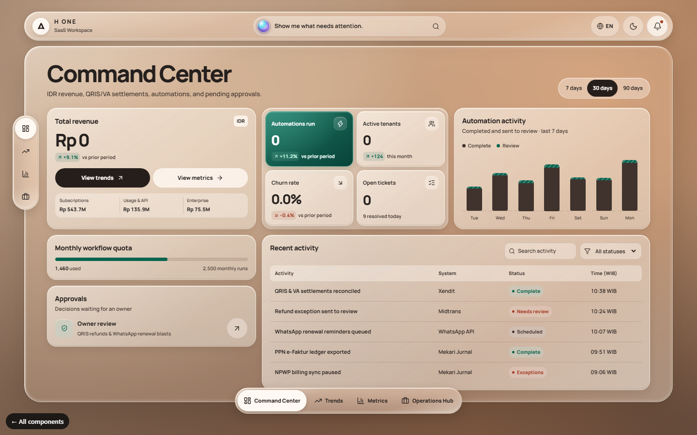
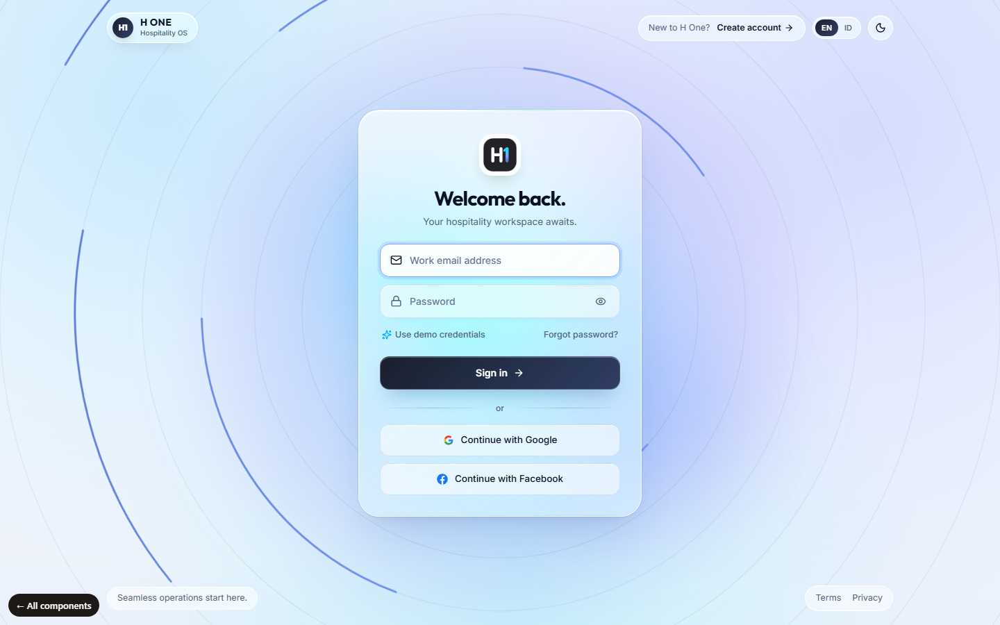
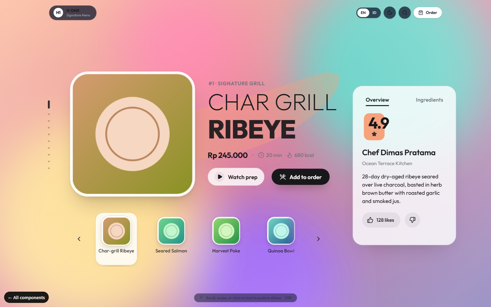

# H One UI Showcase

Four UI experiments for a fictional resort, "H One": a glass dashboard, a glass sidebar, an animated sign-in page, and a dish carousel that rotates in an orbit. Each component is one self-contained React file, shown on its own page. All data on screen is made up, and nothing talks to a backend.



| | |
|---|---|
|  |  |
|  | |

## Components

| Page | File | Contents |
|---|---|---|
| `#/glass-dashboard` | `src/components/glass-dashboard.tsx` | Glass dashboard: number cards, a bar chart, an activity table, two languages, dark mode |
| `#/glass-sidebar` | `src/components/glass-sidebar.tsx` | Glass sidebar with nested menus, search, and a compact mode |
| `#/sign-in-animation` | `src/components/sign-in-animation.tsx` | Animated sign-in page (the buttons are for show; there is no real authentication) |
| `#/dish-orbit-carousel` | `src/components/dish-orbit-carousel.tsx` | Orbiting dish carousel you can scroll or swipe (the images are placeholders) |

## Running it

```bash
npm install
npm run dev      # http://localhost:5173
npm run build
```

Needs Node 20 or newer. Stack: Vite, React 19, Tailwind v4, `lucide-react`. The router is a single hash-based function in `src/main.tsx`.

## Notes

- The components were made with AI assistance (vibe coding) and are **left almost unedited** in this repo, so they are not strictly typed: `src/components` is excluded from `npm run typecheck`. Tidy up the types before using them in a real project. The only changes: the Unsplash photos were replaced with colored placeholders, and three background opacity values in the carousel CSS were raised or lowered so the glass effect shows.
- Every name, number, and piece of text on screen is fictional.
- The dish images in the carousel are gradient placeholders drawn in code (SVG), not photos. Replace `centeredDishUrl` and `BACKDROP_WALL` with your own photos if you like. The only outside resource is the Google Fonts stylesheet, loaded when a page opens.
- The MIT license below covers everything in the repo.

## License

MIT. See [LICENSE](LICENSE).
