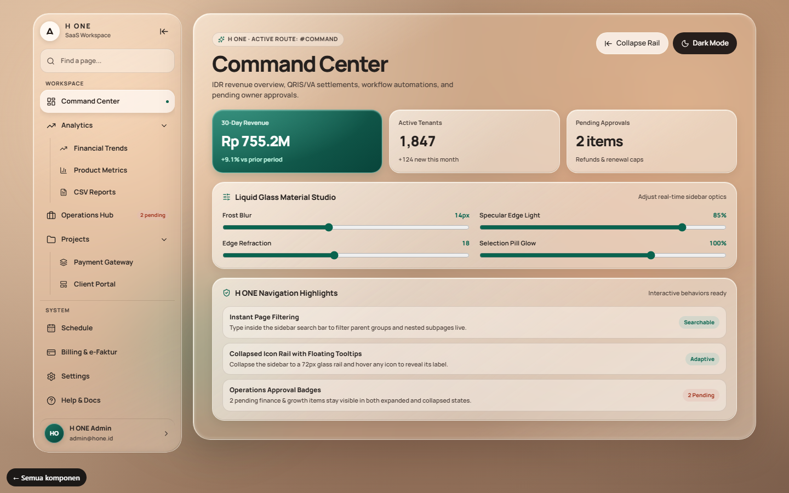

# H One UI Showcase

Empat komponen UI eksperimen untuk resort fiktif "H One": dashboard kaca, sidebar kaca, halaman masuk beranimasi, dan carousel hidangan yang berputar. Tiap komponen satu file React yang berdiri sendiri, ditampilkan di halaman terpisah.

*English: four self-contained React UI experiments (glass dashboard, glass sidebar, animated sign-in, orbiting dish carousel) for a fictional resort, one page each, built with Vite. All data on screen is made up; nothing talks to a backend.*


| | |
|---|---|
|  |  |
|  | |

## Komponen

| Halaman | File | Isi |
|---|---|---|
| `#/glass-dashboard` | `src/components/glass-dashboard.tsx` | Dashboard kaca: kartu angka, grafik batang, tabel aktivitas, dua bahasa, mode gelap |
| `#/glass-sidebar` | `src/components/glass-sidebar.tsx` | Sidebar kaca dengan menu bersarang, pencarian, mode ringkas |
| `#/sign-in-animation` | `src/components/sign-in-animation.tsx` | Halaman masuk beranimasi (tombol hanya tampilan, tidak ada autentikasi nyata) |
| `#/dish-orbit-carousel` | `src/components/dish-orbit-carousel.tsx` | Carousel hidangan mengorbit, bisa di-scroll atau di-swipe (gambar berupa placeholder) |

## Menjalankan

```bash
npm install
npm run dev      # http://localhost:5173
npm run build
```

Butuh Node 20 atau lebih baru. Stack: Vite, React 19, Tailwind v4, `lucide-react`. Router-nya satu fungsi berbasis hash di `src/main.tsx`.

## Catatan

- Komponen dibuat dengan bantuan AI (vibe coding) dan **sengaja nyaris tidak diedit** di repo ini (perubahan: foto Unsplash diganti placeholder berwarna, dan tiga nilai opacity latar di CSS carousel dinaikkan atau diturunkan agar efek kaca terlihat), jadi belum diketik ketat: `src/components` dikeluarkan dari `npm run typecheck`. Rapikan tipenya dulu sebelum memakainya di proyek sungguhan.
- Semua nama, angka, dan teks di layar fiktif.
- Gambar hidangan di carousel adalah placeholder gradien yang dibuat di kode (SVG), bukan foto. Ganti `centeredDishUrl` dan `BACKDROP_WALL` dengan fotomu sendiri bila perlu. Satu-satunya sumber luar adalah font dari Google Fonts, yang dimuat saat halaman dibuka.
- Lisensi MIT di bawah berlaku untuk seluruh isi repo.

## Lisensi

MIT. Lihat [LICENSE](LICENSE).
